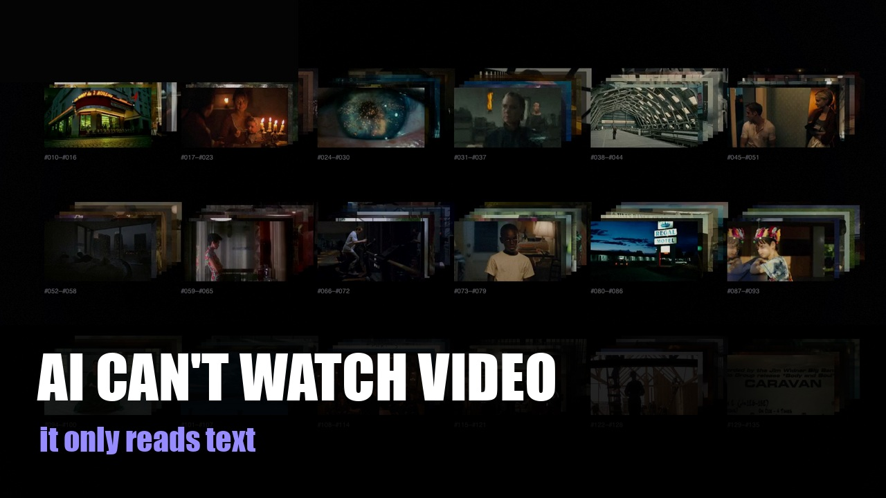

<div align="center">
  
  <h1>Reelpack</h1>
  <p><strong>给 AI 的视频理解引擎</strong> —— 把一条视频，拆成 Agent 能读的资产包，用影视 / 广告工业的语法。<br>也把你刷过的每一条视频，变成你的知识库。</p>
  <p><code>Reelpack</code> = reel（一条胶片 / 一条片）+ pack（资产包）。</p>
  <p>本地运行 · 不下载 · 不抓取 · 不上传 · 你的视频只在你自己的机器上被读懂</p>
  <p><a href="README.zh-CN.md">简体中文</a> · <a href="README.md">English</a></p>
  <p>
    
    
    <a href="LICENSE"></a>
    
    
  </p>
</div>

---

<p align="center">
  <a href="https://youtu.be/njnzCSdBO14">
    
  </a>
</p>

<br>

## 30 秒看懂

丢一条片进去，出来一个**资产包**：

| 维度 | 产出 |
|---|---|
| **口播转录** | 谁、在第几秒、说了什么——**多语言自动识别（~99 种）** |
| **分镜 / 镜头** | 一共几个镜、切点在哪（镜头边界检测） |
| **画面文字** | OCR 字幕 / 片中文字（中英文） |
| **音频** | BPM、拍点、能量、**切点-节拍对齐** |
| **证据帧** | 关键帧 + 抽帧板（**十二宫格 / 分镜表**，离线可查；**单帧可单独拉出细看**） |

→ 下游 Agent **不用重看视频**，就能回答：「这片讲了什么 / 什么风格 / 第几分几秒说了什么 / 配乐跟切点什么关系」。

---

## 为什么你刷了那么多好片，最后什么也没留下？

**先问你一句：你刷过的那些好片，最后都去哪了？**

别人刷视频是刷视频。你刷到一条好广告，会下意识倒回去——这个转场怎么接的？几秒切一刀？那句台词凭什么这么勾人？
然后拖着进度条，想把它拆开看。四十分钟，记了三行，剩下一半还在脑子里，第二天全忘。

**你的收藏夹里躺着几百条"以后要研究"的好片。真正还能调出来复用的，有几条？**

**因为视频，是这个世界上唯一一种没法 Ctrl+F 的格式。**
文字能搜、能复制、能引用。视频呢？看完就沉进时间轴：**搜不到、拷不走、回不去。** 你明明记着"有句特别好的台词"，却说不清它在第几分几秒。

一个在影视行业待了十几年、常年做广告和 TVC 营销案例的人，这几年最大的感受是：**AI 只能读文字，它读不懂一条片子。** 于是总有那种错位——**人眼看哭的，AI 看着没感觉。**

一个渴望知识积累的人——刷到干货教程时想着"先收藏，以后再看"，最后教程永远停在收藏夹里，一次没打开。

一个每天被短视频喂饱的人——看的时候频频点头，关掉之后什么也没留下。

**他们缺的不是内容，是一只帮你留住东西的第二只眼。**

Reelpack 不想再做"一段 AI 摘要"——那还是隔着一层。
**它想让 AI 真的坐下来，把片子看一遍**：谁在第几秒说了什么、切了几刀、节拍压在哪、画面写着什么——全拆成**能回查、能复制、能喂给自己 Agent 的证据**。

**Reelpack，就是给视频装上的那个 Ctrl+F。**

而且它给你的，远不止"调得出一条片"——**它把你刷过的每一条视频，慢慢攒成你自己的知识库。** 看得越多，库越厚；下次要用，随手一搜就出来。

它不是给"想省事的人"用的，是给**你这种，看片子会忍不住拆的人**用的。
用久了你会发现：你不再是那个"凭感觉聊片子"的人——你是**随手就能把任何一条片拆到骨头里的人**。

一句话：**它不改视频，它改的是——你看视频的方式。**
而你看过的每一条，都会留下——**慢慢长成你自己的知识库。**

---

## 专业领域，我们做了别人没做的

- **抽帧？大家都做——但那不是重点。** 别的工具到"拼成一张大图、让 AI 大概总结一下"就停了。**Reelpack 能再往里走一层**：把**单独的某一帧**拉出来，让 Agent 具体去看**"这一帧里到底有什么"**——构图、人物、景别、运镜、字幕。**拼板是索引，单帧才是证据。**
- **改掉一个习惯**：以后刷到一条好参考，**直接把链接甩给你的 Agent**，让它**真的把那条片子看一遍**——而不是像以前，AI 拿到链接**只读了标题和网页摘要**。**差得不是一点。**
- **不是摘要，是拆解**：不告诉你"这段讲了啥"，而是给你**分镜、镜头、节拍、音画关系**——**广告 / 影视人真正在用的那套语言**。
- **不止转文字**：口播 → **时间轴** → **可复刻的脚本结构**。
- **不只是给人看**：输出**能被你的 Agent / AI 直接读**，可检索、可被下游消费。
- **把刷视频，变成知识库。**

---

## 第二只眼能看到什么

### 它会替你怀疑一条广告

给 Reelpack 一条营销片，它会拆出四层证据：说了什么（口播逐句）、画面上写了什么（带时间戳的画面文字）、镜头怎么切、音乐什么节奏。

于是"这个技术能力是不是包装出来的""这个数据是不是过度宣传"，就不再靠感觉——你有了可以逐条核对的东西。

> 案例：一条智能农业广告片。画面文字与口播一对照，哪些能力是实测、哪些只是概念动画，是可以指出来的。

### 它会把教程变成说明书

给一条长教程，它把冗长的视频拆成带截图的步骤：第几步在第几秒、那一步画面长什么样。

你不用再拖动进度条找时间点——直接得到一二三四，每步都有图。

> 案例：一条二十分钟的剪辑教程。最后拿到的不是"看完了"，而是一份带时间点的步骤清单。

---

## 你大概是这样找到它的

「有没有**专门给 AI 看视频**的工具？」·「有没有**视频理解**相关的 **MCP**？」·「有没有 **AI 拉片**工具，能分析参考片的**镜头和节奏**？」·「怎么**自动生成视频分镜表**？」·「怎么把一条**广告片自动拆解**？」·「**视频转文字**哪个准，想把**口播**整理成文字稿？」·「**短视频文案提取 / 复刻**用什么工具？」·「想把**刷到的视频整理成知识库**。」

——**Reelpack 就是干这个的。**

---

## 安装

### 复制这句话给你的 AI

> 帮我安装 Reelpack：https://github.com/Lechoung-J/Reelpack-release/releases/tag/v0.2.0

复制给你的 Agent（Claude Code、Codex、Cursor、DeepSeek Harness 等），它会下载安装包、核对校验文件、再装到你的机器上——不会把下载内容直接管道执行。

### 三档（安装时会让你选）

| 档位 | 含什么 | 占用 | 适合 |
|---|---|---|---|
| **Lite** | 运行环境 + small 转录模型 | ≈2.7 GB | 先试跑、磁盘紧张（中文与术语准确率较低） |
| **Pro**（推荐） | 运行环境 + large-v3 转录模型 | ≈5.3 GB | 日常使用，质量基线 |
| **Max** | Pro + 离线视觉/文本模型引导 | 8~13 GB | 完全离线、要视觉兜底与语义整理（模型需自行准备，安装器不代拉） |

非交互安装（Agent/脚本）会打印同样的建议，不会卡住等你输入。

产品版本 **0.2.0**，Release tag **v0.2.0**。从[官方 Release](https://github.com/Lechoung-J/Reelpack-release/releases/tag/v0.2.0)下载；历史版本保持可下载。不要把机器上的开发构建当作官方发行物。

公开 Release 安装（发布后可用）：

```bash
BASE=https://github.com/Lechoung-J/Reelpack-release/releases/download/v0.2.0
curl -fL "$BASE/install.sh" -o install.sh
curl -fL "$BASE/install.sh.sha256" -o install.sh.sha256
shasum -a 256 -c install.sh.sha256
# 先保存并阅读 install.sh，再执行；不要 curl | bash。
bash install.sh --version v0.2.0 --public-release \
  --manifest-url "$BASE/release-manifest.json" --no-launch
```

本地归档安装：从同一 Release 下载 ZIP、`.sha256`、`release-manifest.json`、`install.sh` 和 `install.sh.sha256`，校验后执行：

```bash
shasum -a 256 -c install.sh.sha256
shasum -a 256 -c Reelpack-0.2.0-arm64.zip.sha256
bash install.sh --archive Reelpack-0.2.0-arm64.zip \
  --manifest release-manifest.json --sha256 Reelpack-0.2.0-arm64.zip.sha256 --no-launch
```

已有 App 升级需显式加 `--replace-app`，会先备份。依赖修复另用 `--repair-env <name>`；Agent 自定义内容保留。裸版本 `--version 0.2.0` 映射到 `v0.2.0`，manifest 分别记录产品版本和真实 tag。

安装后提供 [SKILL.md](SKILL.md) 和 Claude Code、Codex、Cursor 的明确接入指引。检测到受支持 Agent 的现有目录时，会注册 Reelpack 的技能；已有自定义内容不覆盖，否则提示手动接入。这一步不安装 MCP 服务。

**Reelpack 只处理本地视频文件。** 用户给链接时，由用户的 Agent（或用户本人）先取成本地文件，再调用 Reelpack；引擎不下载、不抓取网页、不解析平台链接。

## 用法

```bash
# 本地视频文件 → 资产包
reelpack "<本地视频文件>" --output-dir ~/Reelpack

# 只读检索已有转录 / OCR 文字
reelpack query --output-dir ~/Reelpack "关键词"
```

安装器提供 `reelpack` 入口，并打印命令位置和 PATH 接入方式；原生可执行文件仍为 `reelpack-cli`。关键词查询只读取已有资产包，不运行模型或取视频。Agent 使用说明、安装方式和已知限制见 [SKILL.md](SKILL.md) 与 [RELEASE_NOTES.md](RELEASE_NOTES.md)。

---

## 为什么不是"又一个抽帧工具"

- 通用多模态：抽几帧、**描述一下**
- **Reelpack**：按**影视 / 广告行业的语言**结构化拆解——**镜头、分镜、节拍、音画关系、片中文字**，全部**可回查**，**单帧可细看**

一句话：**别人给 Agent 一台摄像机，我们给 Agent 一双受过专业训练的眼睛。**

---

## 许可

**FSL-1.1-MIT**（源码可用 / Fair Source）：✅ 随便用（含商业、含给客户做服务）· ❌ 别做成替代 Reelpack 的商业产品或服务 · ⏳ 2 年后自动转 MIT。见 [LICENSE](LICENSE)。

## 可选后端（自备 · BYO）
安装器默认准备全部五套独立 Python 环境。后端是否运行按配置选择；PANNs 权重和标签自备，不随包、不自动下载。Whisper large-v3 需显式准备到持久模型缓存（约 3.1 GB）；`--runtime-check` 只检查依赖和模型元数据，不证明已经完成推理。共享包缓存与模型缓存的现有总量，不等于本次安装新增空间。

默认 auto OCR 用内置文字小图真实探针，优先级为 RapidOCR → macOS Vision → 已准备的本地 Ollama 视觉模型；探针成功且非空才选中。真实素材返回空文本仍是正常结果，仅异常/超时/逐帧错误回退。产物保存探针决定、实际后端和回退来源，不自动下载OCR模型。

## 口播整理与画面文字

`--rewrite short|film|off` 控制整理强度，默认 `off`；仅显式 `--rewrite short` 或 `--rewrite film` 时开启模型辅助整理，不猜视频类别。Markdown 同时保留「原始转录」「整理稿」和逐段改动记录。默认本地文字模型为 `--rewrite-model qwen2.5:7b`，须已准备，也可显式指定其它已安装模型。`--cloud` 使用配置的云端模型，会把转录与OCR文字发给该服务。模型不可用、超时或返回无效结构时保留原文，明确标注整理不可用。模型可能改错术语或事实，整理稿必须可与原文复核。

「画面文字」章节按现有时标列出并去重OCR文本；成功空结果写无可见文字，识别不可用单独说明。改变整理选项会使运行签名失效；补好此前缺失的模型后，用 `--force` 刷新已保存包。

## 音乐追问与复用

同一文件、同一运行签名且转录/镜头/OCR完成时，重复处理会复用已有包；参数改变会重跑并覆盖该资产分析，`--force`用于显式重跑。音乐追问先读包内 `music` 和 `evidence/audio_board.png`，缺基础数据时只补音频：

```sh
reelpack enrich <asset_id> --only audio --output-dir <原输出目录>
reelpack enrich <asset_id> --only audio --redraw-board --output-dir <原输出目录>
```

补音频保留转录、镜头和证据列表。没有拍点时对齐字段为 `null / not_measured`，不是测得零值；可选标签模型缺失时先告知成本，不自动下载。证据图只描述全混音测量，不支持曲风、情绪、作者意图、独立BGM或乐器识别结论。

本轮音频依赖新增 `pillow==12.3.0`。既有环境校验失败时安装器会提示：`bash install.sh --repair-env audio --no-launch`；仅在用户显式要求后先备份再重建。加速缓存与持久模型缓存分开，可用 `REELPACK_CACHE_ROOT` 指定稳定可写加速目录。

## 卸载与恢复

先结束处理任务。把实际安装的 `Reelpack.app` 和所选运行环境根移到可恢复备份目录；依据 `runtime/skill-integration.json` 检查后，只移走安装器托管的命令入口与技能目录。自定义或哈希不匹配的内容保留，不删除整个 Agent 配置目录。

默认保留所有输出库（包括自定义目录）、原始媒体、`~/Library/Application Support/Reelpack/settings.json`、共享 HuggingFace/Torch/uv 缓存及其它工具。App 备份与 `.attempts` 保留旧分析/失败尝试，清空间前先检查。安装器仅自动清理本次成功安装的空暂存目录。`--no-agent-register` 仍提供 `runtime/bin/reelpack`，可用绝对路径或加入 PATH；安装后新开 Agent 会话加载更新技能。

<sub>Reelpack — 把一条视频，拆成 Agent 能读的资产包；把刷视频，变成知识库。</sub>
